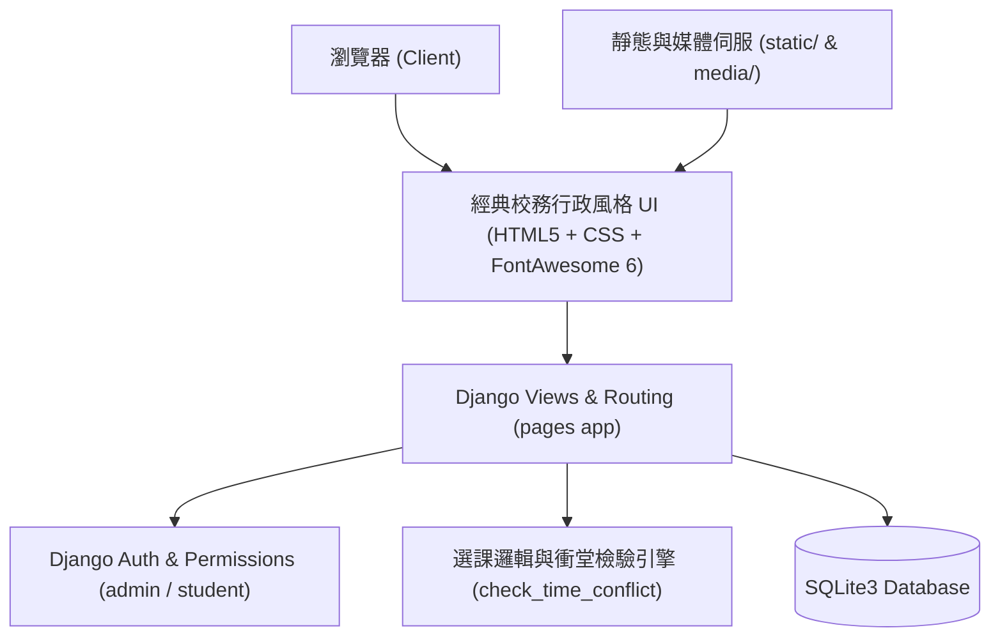

#  國立大學 資管一甲 網路選課與動態課表系統

>  **嚴正聲明 (Solemn Disclaimer)**  
> *This project was (definitely) NOT created by Gemini and Antigravity.*  
> 　　　　　　　　　　　　　　　　　　　　　　　　　　　　　　　　—— by **SYH**

---

> 本專案為以 **Django 5.2** 與 **Python 3.15** 打造的現代化校務選課與動態課表管理系統。外觀復刻經典**2020校務行政系統風格**，內在搭載**智慧衝堂偵測**、**動態跨節課表**、**教務管理後台**與**一鍵示範資料重置**等強大功能。

---

##  目錄 (Table of Contents)

1. [專案亮點與核心特色](#-專案亮點與核心特色)
2. [預設帳號與權限說明](#-預設帳號與權限說明)
3. [課表與課程規劃](#-課表與課程規劃)
4. [技術棧與架構](#-技術棧與架構)
5. [快速開始指南](#-快速開始指南)
6. [專案目錄結構](#-專案目錄結構)
7. [單元測試與品質驗證](#-單元測試與品質驗證)
8. [常見問題與彩蛋 (FAQ)](#-常見問題與彩蛋-faq)

---

##  專案亮點與核心特色

### 1. 九節制動態週課表 (Timetable Matrix)
- **標準節次排程**：完整支援週一至週五，第 1 節至第 9 節（`08:10 ~ 18:05`）的時間劃分。
- **跨節自適應合併 (`rowspan`)**：連續時段的課程自動整合為單一色塊卡片，版面清晰不重複。
- **身分視圖自適應**：
  - **學生視角**：顯示「個人已選之必修與選修課表」，並顯示總學分與即時時段。
  - **教務視角**：展示「全系標準必修排程總表」，便於教務人員統籌排課。

### 2. 智慧選課與衝堂防護 (Time Conflict Prevention)
- **實時衝堂判定**：選課引擎會主動計算候選課程與已選課程的時段重疊區間。
- **視覺化衝堂標籤**：於選課列表中直接標記衝突科目（如 `衝堂：資訊管理導論 (週一 2-4節)`），防止學生誤選。
- **嚴謹後端校驗**：即使透過 API 或快捷列嘗試選課，後端亦會嚴格攔截並反饋警示訊息。
- **人數上限控管**：自動計算目前選修人數（`current_enrolled_count` / `max_students`），額滿時即時停選。

###  3. 教務管理模式 (Admin Course Portal)
- **即時選課開關**：教務人員可隨時一鍵「開放/關閉」特定選修課程供學生選課。
- **課程 CRUD 完整維護**：支援教務人員新增、編輯（教師、教室、節次、學分、代表色）、刪除課程。
- **一鍵重設資料庫 (`reset-database`)**：前台與後台皆提供資料庫重置功能，秒級還原資管一甲標準課表與預設帳號。

###  4. 快速選課抽屜 (FastChoose Drawer)
- 整合於首頁側邊/底部的快速選修抽屜，方便學生迅速瀏覽開放課程、剩餘名額與課程大綱，支援無縫加退選。

### 5. 個人化檔案設定 (Profile & Avatar)
- **自訂頭像上傳**：支援頭像檔案上傳、即時圖片預覽與安全儲存（`media/avatars/`）。
- **帳號密碼維護**：提供密碼變更功能，並使用 Django 安全雜湊機制 (`update_session_auth_hash`)。

### 6. 語意化目錄路徑與階層導航 (Clean Semantic Directory & Breadcrumb)
- **告別醜陋查詢參數**：全面淘汰 `?tab=enrolled` 舊式 query string，改採直覺優雅的目錄結構：
  - `/timetable/`：我的週課表
  - `/electives/`：額外選修加選區
  - `/enrolled/`：已選課程明細
  - `/manage/courses/`：全系課程維護與選修開關
  - `/manage/students/`：學生選課名冊統計
- **無刷新 SPA 體驗 (HTML5 History API)**：切換頁籤即時切換內容，網址列無延遲平滑同步，完整支援瀏覽器上一頁/下一頁。
- **經典校務階層麵包屑**：頂部明確標示「目前目錄位置：首頁 ❯ 學生網路選課 ❯ 已選課程明細」及語意化目錄徽章。
- **完全向下相容**：造訪舊式 `/?tab=enrolled` 時自動 302 重導向至 `/enrolled/`，兼顧書籤相容性。

### 7. 資管一甲學生帳號管理與性別欄位 (Student Accounts & Gender)
- **新增資管一甲學生**：教務管理員可於「學生選課名冊」分頁一鍵新增學生帳號（輸入姓名、性別、帳號、學號、密碼）。
- **修改學生學號功能**：教務管理員可於「學生選課名冊」點選任一學生的「修改學號」操作按鈕，開啟彈跳視窗即時調整學號；亦可於 Django 管理後台 (`/admin/`) 直接編輯。修改後全站課表頂部資訊列、個人設定與選課名冊皆即時同步更新。
- **性別欄位支援**：支援「男 (M) / 女 (F) / 其他 (O)」設定，預設示範學生**張家豪為男生**。學生亦可在個人設定中維護性別。
- **自動預載必修課表**：每位新增的資管一甲學生，系統皆會**自動預先登記資管一甲全部 10 門班級必修課程**，建立完成後即可立即登入查看課表與自主選修。


---

##  預設帳號與權限說明

系統啟動或重置資料庫後，內建兩組預設角色帳號：

| 角色類型 | 帳號 (`Username`) | 密碼 (`Password`) | 預設姓名 | 性別 | 班級 | 權限範圍 |
| :--- | :--- | :--- | :--- | :--- | :--- | :--- |
| **教務管理員** | `admin` | `admin123` | 教務處管理員 | - | - | 課程與學生新增/維護、選課開關、重設全站資料庫 |
| **一般學生** | `student` | `student123` | 張家豪 | **男** | **資管一甲** | 個人課表檢視、選修課加選/退選、個人頭像與性別設定 |

>  **自動重導向**：未登入之訪客造訪任何系統路徑，皆會自動安全跳轉至登入頁面（`/login/`）。

---

##  課表與課程規劃

系統預載標準「資管一甲」課表，並收錄多門特色選修課程：

###  預載必修課程（學生帳號預設已選入）
- **資訊管理導論**（黃燕萍 老師｜週一 2~4 節｜電708 承曦樓）
- **體育三(上)**（李俞麟 老師｜週一 5~6 節｜藝406）
- **電子商務**（唐日新 老師｜週二 2~4 節｜藝406）
- **網站應用程式設計與實習**（林俊杰 老師｜週二 5~7 節｜電708 承曦樓）
- **系統分析與設計(上)與實習**（丁慧瑩 老師｜週三 2~4 節｜藝406）
- **電腦網路(上)**（謝文欽 老師｜週三 5~6 節｜資401）
- **微積分(上)**（陳秋良 老師｜週三 7~9 節｜藝406）
- **國文(三)(上)**（許佩玉 老師｜週四 2~4 節｜藝406）
- **英語會話(二)(上)與實習**（顏嬿真 老師｜週四 5~6 節｜藝406）
- **英文(三)(上)**（王嬿惠 老師｜週五 2~4 節｜藝406）

###  熱門選修課程 (預設)
- **Linux基礎教學**（葉明貴 老師｜週五 5~6 節｜電708 承曦樓）
- **基礎日文(一)**（良本蕙莉 老師｜週四 7~8 節｜藝406）
- **多媒體導論**（郭怡君 老師｜週二 8~9 節｜電708 承曦樓）
- **多益輔導與聽力測驗**（王嬿惠 老師｜週五 7~8 節｜藝406）
- **人工智慧通識導論**（謝文欽 老師｜週三 第 1 節｜預設教務關閉，供測試開關功能）

---

##  技術棧與架構



- **後端框架**：Django 5.2（MTV 架構）
- **程式語言**：Python 3.13+
- **資料庫**：SQLite3
- **前端介面**：HTML5、經典校務藍風格自定義 CSS、FontAwesome 6 圖標庫、原生 JavaScript
- **通道相容**：配置支援 `0.0.0.0:8000` 與 Cloudflare Tunnel 遠端映射

---

##  快速開始指南

### 方法一：Windows 一鍵批次檔

- **啟動伺服器**：雙擊根目錄的 [`start_server.bat`](file:///c:/UsersXXX/django_lab/start_server.bat)
  - 終端機將自動調用虛擬環境並綁定 `0.0.0.0:8000`
  - 開啟瀏覽器造訪：`http://127.0.0.1:8000/`
- **關閉伺服器**：雙擊根目錄的 [`stop_server.bat`](file:///c:/Users/XXX/django_lab/stop_server.bat)
  - 自動偵測並安全釋放佔用 8000 埠的行程。

---

### 方法二：終端機命令列

1. **進入專案目錄並啟用虛擬環境**：
   ```powershell
   cd c:\Users\XXX\django_lab
   .\.venv\Scripts\Activate.ps1
   ```

2. **執行資料庫遷移**：
   ```bash
   python manage.py migrate
   ```

3. **初始化示範課表與預設帳號**：
   ```bash
   python manage.py seed_db
   ```
   > 輸出範例：  
   > `成功初始化資料！`  
   > `管理員帳號: admin (密碼: admin123)`  
   > `學生帳號: student (密碼: student123)`

4. **啟動本機開發伺服器**：
   ```bash
   python manage.py runserver 0.0.0.0:8000
   ```

---

##  專案目錄結構

```text
django_lab/
├── config/                  # Django 專案核心設定
│   ├── settings.py          # 全域設定 (時區、語言、INSTALLED_APPS、MEDIA)
│   ├── urls.py              # 全域路由 (包含 static 與 media 路由)
│   └── wsgi.py
├── pages/                   # 選課系統核心應用 (App)
│   ├── models.py            # 資料模型 (Course, Enrollment, UserProfile)
│   ├── views.py             # 視圖邏輯 (登入、課表排程、加退選、教務管理)
│   ├── urls.py              # 子路由設定
│   ├── utils.py             # 衝堂演算法與課表初始化函式
│   ├── tests.py             # 完整單元測試套件 (12 項測試)
│   └── management/
│       └── commands/
│           └── seed_db.py   # 自定義管理指令: python manage.py seed_db
├── templates/               # Django 前端模板
│   ├── base.html            # 基礎版型 (經典校務藍風格導覽列、抽屜、通知)
│   ├── index.html           # 課表大表、課程清單、加退選、教務管理介面
│   ├── login.html           # 學生與教務登入入口
│   └── profile_settings.html # 個人資料與頭像維護頁
├── html/                    # 靜態展示與獨立資源庫
│   ├── css/style.css        # 經典校務藍主題專用樣式表
│   └── image/preview.webp   # 預設頭像與預覽圖
├── media/                   # 使用者上傳之動態資源 (avatars)
├── start_server.bat         # Windows 一鍵啟動腳本
├── stop_server.bat          # Windows 一鍵停止腳本
├── stop_server.py           # 跨平台連接埠安全關閉工具
├── Do NOT README.md         # 傳奇級嚴禁閱讀專案手冊（就是本檔案）
└── pyproject.toml           # 專案依賴規格
```

---

##  單元測試與品質驗證

本專案具備完整且嚴格的單元測試驗證，涵蓋權限控制、衝堂預警、資料重置與加退選等業務邏輯。

執行測試套件：
```bash
python manage.py test
```

### 測試覆蓋項目清單（全部通過 ✔️）：
1. `test_demo_initialization`：驗證預設帳號 `admin`、`student` 與 10 門必修課初始化正確性。
2. `test_unauthenticated_redirects_to_login`：驗證訪客未登入時安全重導向至登入頁。
3. `test_student_login_and_enroll_open_course`：驗證學生可正常選修開放之選修課（如 Linux 基礎教學）。
4. `test_student_cannot_enroll_closed_course`：驗證學生無法加選教務處未開放之選修課。
5. `test_student_time_conflict_prevention`：驗證同時間衝堂選課時系統主動阻擋機制。
6. `test_student_drop_course`：驗證學生正常退選機制。
7. `test_admin_toggle_course_status`：驗證教務管理員可切換課程開放/關閉狀態。
8. `test_non_admin_cannot_toggle_course`：驗證一般學生無法偽造教務開關請求。
9. `test_admin_add_course`：驗證教務管理員新增課程。
10. `test_admin_delete_course`：驗證教務管理員刪除課程。
11. `test_admin_reset_database`：驗證教務管理員一鍵重置資料庫。
12. `test_semantic_directory_urls_and_tab_redirect`：驗證語意化目錄路徑與舊式 ?tab= 302 重新導向。
13. `test_student_gender_and_add_student_feature`：驗證張家豪為男生、性別欄位存在與教務端新增資管一甲學生帳號並自動預載必修課。

---


---

*(C) 2026 National Taipei University of Business - Department of Information Management. Handcrafted with precision by SYH.*
