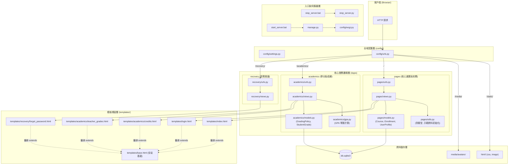
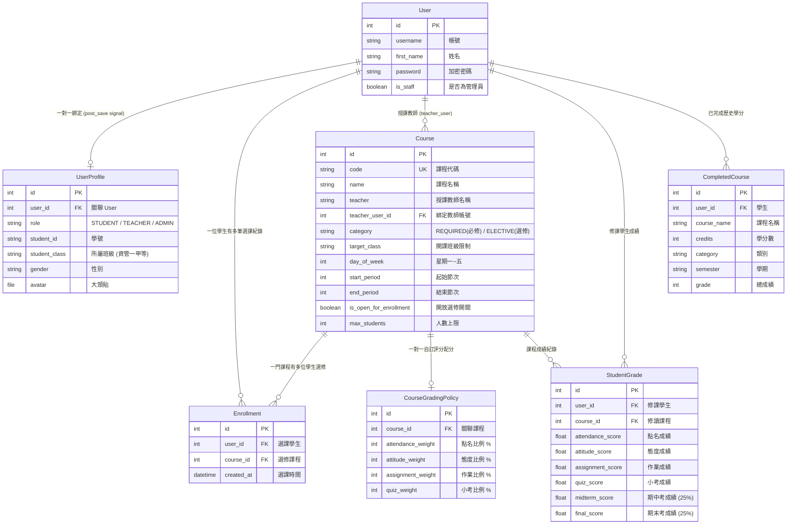

# 專案檔案關係架構樹狀圖 (Project Architecture & File Tree)

本專案為基於 **Django** 架構開發之「國立大學 資訊管理學系 網路選課與動態課表系統」。  
本文件以樹狀圖與流程關係圖，完整梳理專案中所有應用程式（Apps）、檔案結構、資料庫模型關聯（ER）、路由分派（URLs）以及前後端模板（Templates）之依賴關係。

---

## 1. 專案目錄與檔案樹狀結構 (Directory & File Tree)

```text
django_lab/                                  # 專案根目錄
├── manage.py                                # Django CLI 指令入口 (runserver, test, makemigrations, etc.)
├── start_server.bat                         # Windows 一鍵啟動腳本 (純 ASCII 啟動器，呼叫 start_server.py)
├── start_server.py                          # 服務啟動 Python 腳本 (輸出 UTF-8 繁中資訊，啟動 0.0.0.0:8000)
├── stop_server.bat                          # Windows 一鍵關閉腳本 (純 ASCII 啟動器，呼叫 stop_server.py)
├── stop_server.py                           # 服務關閉 Python 腳本 (以 netstat 搜尋並結束佔用 Port 8000 之 PID)
├── .gitattributes                           # 確保 *.bat 於 Git 簽出時維持 CRLF 格式
├── db.sqlite3                               # 預設 SQLite 關聯式資料庫
├── pyproject.toml / requirements.txt        # 專案依賴管理與套件清單 (Django >= 6.1.1 等)
├── README.md                                # 專案說明文件 (系統特色、預設測試帳號、啟動說明)
│
├── config/                                  # 【全域專案配置層】
│   ├── __init__.py
│   ├── settings.py                          # Django 全域設定 (已安裝 App、資料庫、中間件、模板與靜態檔案路徑)
│   ├── urls.py                              # 全域頂層路由分派器 (掛載 pages, academics, recovery, static, media)
│   ├── wsgi.py                              # WSGI 伺服器部署介面
│   └── asgi.py                              # ASGI 非同步伺服器部署介面
│
├── pages/                                   # 【主選課與校務入口 App】
│   ├── models.py                            # 核心資料模型 (Course, Enrollment, UserProfile)
│   ├── views.py                             # 核心視圖邏輯 (首頁 5 大 Tab 課表/選課/維護、一鍵開關選修課、身分驗證)
│   ├── urls.py                              # pages 專屬語意化目錄路由 (/timetable/, /electives/, /manage/...)
│   ├── utils.py                             # 輔助函式庫 (初始示範資料建立、防衝堂演算法 check_time_conflict)
│   ├── admin.py                             # Django 原生後台註冊 (CourseAdmin, CourseAdminForm)
│   ├── apps.py                              # PagesConfig 應用設定
│   ├── tests.py                             # 系統單元測試與資安驗證 (選課衝突、選修開關、防暴力破解等 53 項測試)
│   ├── management/                          # 自訂 Django Management Commands
│   │   └── commands/
│   │       └── seed_db.py                   # 手動填充初始資料庫指令 (python manage.py seed_db)
│   └── migrations/                          # pages 資料庫遷移版本記錄檔
│
├── academics/                               # 【學分進度與成績評分 App】
│   ├── models.py                            # 成績模型 (CourseGradingPolicy, StudentGrade, CompletedCourse)
│   ├── views.py                             # 學分審核進度、GPA 試算、任課教師評分與自訂配分視圖
│   ├── urls.py                              # academics 專屬路由 (/academics/credits/, /teacher/grades/)
│   ├── gpa.py                               # 4.3 制 GPA 加權計算與成績等第 (A+, A, ...) 換算模組
│   ├── forms.py                             # 歷年修課表單 (CompletedCourseForm)
│   ├── admin.py                             # Django 原生後台註冊
│   ├── apps.py                              # AcademicsConfig 應用設定
│   ├── tests.py                             # 成績計算、及格通過判定與配分比例單元測試
│   └── migrations/                          # academics 資料庫遷移版本記錄檔
│
├── recovery/                                # 【帳號安全與密碼重設 App】
│   ├── views.py                             # 學生密碼找回邏輯 (學號+姓名+帳號三重核驗，配合 Cache 防暴力猜測)
│   ├── urls.py                              # recovery 路由 (/recovery/forgot-password/)
│   └── tests.py                             # 密碼重設成功/失敗/防爆破次數限制單元測試
│
├── templates/                               # 【前後端渲染模板層 (Django Templates)】
│   ├── base.html                            # 全系統基底模板 (導航列、側邊欄、全域 CSS 變數、Toast 訊息容器)
│   ├── index.html                           # 主系統核心介面 (含 5 大 Tab：週課表、選課中心、修課清單、教務維護、名冊)
│   ├── login.html                           # 系統登入頁面
│   ├── profile_settings.html                # 個人檔案與頭像上傳/密碼修改頁面
│   ├── academics/
│   │   ├── credits.html                     # 學生學分進度、GPA 統計與歷年修課明細
│   │   └── teacher_grades.html              # 教師自訂配分權重、輸入學生平時/期中/期末成績介面
│   └── recovery/
│       └── forgot_password.html             # 忘記密碼身分核驗與密碼重設頁面
│
├── html/                                    # 【靜態資源存放層 (Static Files)】
│   ├── css/
│   │   └── style.css                        # 2020 經典校務行政風格 CSS 樣式表
│   ├── image/                               # 系統圖示、預覽縮圖 (preview.webp)
│   ├── favicon.ico                          # 網站標題圖示
│   └── index.html                           # (備用靜態展示檔)
│
└── media/                                   # 【使用者上傳媒體檔案 (User Uploaded Media)】
    └── avatars/                             # 使用者上傳之個人大頭貼圖片檔案
```

---

## 2. 模組調用與資料流架構 (Module & Data Flow Architecture)

以下展示各模組與請求（Request）在伺服器內部的流轉關係：



---

## 3. 資料庫實體關聯圖 (Database Entity-Relationship / ERD)

專案各 Model 之間的跨 App 外鍵（Foreign Key）與一對一（One-to-One）連結關係如下：



---

## 4. 各功能模組詳細職責與關聯說明

### 4.1 全域配置層 (`config/`)
- **`config/settings.py`**：定義專案基礎設施。註冊了 `pages`、`academics` 等應用；配置了 `TEMPLATES` 的搜尋路徑（`templates/` 與 `html/`）；設定 `MEDIA_ROOT` 與 `MEDIA_URL`。
- **`config/urls.py`**：頂層 URL 路由轉發。
  - 將根路徑 `''` 轉發至 `pages.urls`。
  - 將 `'academics/'` 轉發至 `academics.urls`。
  - 將 `'recovery/'` 轉發至 `recovery.urls`。
  - 特別加入 `no_cache_serve` 處理靜態資源與媒體大頭貼，確保瀏覽器不產生舊圖快取。

### 4.2 主選課與校務入口 (`pages/`)
- **`pages/models.py`**：
  - `Course`：儲存全系必修與選修課時段、教室、學分、開放狀態、人數上限等。
  - `Enrollment`：紀錄學生自主加選的課程關係。
  - `UserProfile`：擴充原生 Django `User`，儲存學生學號、所屬班級、大頭貼路徑與身分角色（`STUDENT`、`TEACHER`、`ADMIN`）。
- **`pages/views.py`**：
  - `index`：中央視圖，根據分頁代碼（`tab`）渲染週課表、選課清單、教務課程維護或學生名冊。
  - **一鍵開放 / 關閉選修**：由管理員點擊觸發，限定批次更新 `category='ELECTIVE'` 之所有選修課程開關，確保必修課不受影響。
  - `enroll_course` / `drop_course`：學生加退選課程，具備衝堂檢查、人數上限與班級限制校驗。
  - `toggle_course_status`：個別課程開放狀態單鍵開關。
  - `add_course` / `edit_course` / `delete_course`：教務端或授課教師進行課程維護。
- **`pages/utils.py`**：
  - `check_time_conflict`：數學比對星期與節次交集，防止學生衝堂。
  - `init_demo_data`：系統首次啟動時自動填充課表、預設課程與預設測試帳號。

### 4.3 學分審核與成績管理 (`academics/`)
- **`academics/models.py`**：
  - `CourseGradingPolicy`：任課教師自訂點名、態度、作業、小考之平時成績百分比配分。
  - `StudentGrade`：計算個別學生總成績（平時 50% + 期中 25% + 期末 25%），達 60 分判定及格。
- **`academics/gpa.py`**：
  - 提供 `score_to_letter_gp` 與 `calc_gpa`，實現台灣大專院校主流 4.3 績點制（A+ 為 4.3、A 為 4.0 ...）之學分加權 GPA 計算。
- **`academics/views.py`**：
  - `credit_progress`：學生端檢視畢業學分進度表與歷年修課明細。
  - `teacher_grades`：教師端輸入學生成績、調整評分權重。

### 4.4 帳號安全與密碼找回 (`recovery/`)
- **`recovery/views.py`**：
  - `forgot_password`：提供學生忘記密碼自救管道。需同時比對「使用者帳號」、「學號」與「姓名」，完全相符才重設為預設密碼。
  - 整合 `django.core.cache` 實現防暴力猜測保護（連續錯誤 5 次自動鎖定 10 分鐘）。

### 4.5 模板視圖繼承關係 (`templates/`)
- **`templates/base.html`**：
  - 定義全系統標準頂部導覽列（包含校徽、身分徽章、切換角色捷徑、大頭貼、登出按鈕）。
  - 引入全域 CSS、FontAwesome 圖示庫與動態浮動 Toast 訊息提示元件。
- **子模板 (`extends 'base.html'`)**：
  - `index.html`：動態 9 節課表網格、衝堂提醒、課程維護彈窗與一鍵開關按鈕。
  - `academics/credits.html` & `teacher_grades.html`：學分進度條、評分卡片。
  - `login.html` & `recovery/forgot_password.html`：簡潔登入與密碼重設卡片。

### 4.6 維運批次檔與輔助工具
- **`start_server.bat` / `start_server.py`**：採用純 ASCII 批次啟動器與 Python 雙層架構，徹底根絕 Windows CMD 換行編碼錯位與語法解析錯誤，啟動 `0.0.0.0:8000` 並優雅處理 Ctrl+C 中斷訊號。
- **`stop_server.bat` / `stop_server.py`**：透過 Windows `netstat -ano` 解析監聽 Port 8000 之處理程序 PID，並以 `taskkill /F /PID` 乾淨釋放連接埠，避免伺服器重啟時發生衝突。
- **`.gitattributes`**：強制所有批次檔簽出時採用 Windows CRLF (`\r\n`) 格式。
